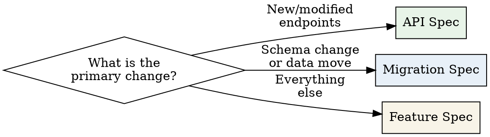

# Spec Writing Skill

## Overview

This skill produces formal software specifications following Spec-Driven Development (SpDD). It generates complete, reviewable specs with RFC 2119 requirements language, traceability to Jira, and clear acceptance criteria.

**What it produces:** A markdown spec saved to `specs/draft/[JIRA-ID]-[short-desc].md`

**Three template types:**
- **Feature Spec** — New features, UI changes, workflow changes, integrations (default)
- **API Spec** — New endpoints, API modifications, contract changes
- **Migration Spec** — Database migrations, data transformations, schema changes

**Output location:** `specs/draft/` — moves to `specs/approved/` after review

---

## When to Use This Skill

### Spec REQUIRED (use this skill)
- New feature development
- API endpoint creation or modification
- Database schema changes or migrations
- Architecture changes affecting multiple services
- Security-sensitive changes (auth, encryption, PII handling)
- Changes affecting external consumers or contracts
- Cross-team dependencies

### Spec NOT required (skip this skill)
- Bug fixes with obvious root cause and solution
- Copy/text changes only
- Dependency version bumps (non-breaking)
- Config changes (feature flags, env vars)
- Test-only changes
- Documentation updates
- Refactors that don't change behavior or interfaces

---

## Core Process

Follow these 7 steps in order. Do not skip steps.

### Step 1: Gather Input

**If a Jira ticket ID is provided:**
Use `mcp__claude_ai_Atlassian__getJiraIssue` to fetch the ticket. Extract:
- Summary and description
- Acceptance criteria (if present)
- Priority and labels
- Linked issues and epic
- Comments with relevant context

**If Jira MCP is unavailable or no ticket ID:**
Work from the plain-text description provided by the user. Ask clarifying questions if the description lacks:
- What problem is being solved
- Who the users/consumers are
- Any known constraints

### Step 2: Pre-Spec Checklist

Before writing, answer these 5 questions (internally — don't output unless helpful):

1. **Who are the stakeholders?** (end users, API consumers, internal teams, ops)
2. **What is the primary success metric?** (user can do X, latency < Y, data migrated by Z)
3. **What are the known constraints?** (tech stack, backward compatibility, timeline, compliance)
4. **What is explicitly out of scope?** (prevents scope creep — name at least 2 things)
5. **What are the biggest risks?** (data loss, breaking changes, performance, security)

### Step 3: Select Template



| Primary Change | Template | Notes |
|---|---|---|
| New/modified API endpoints | `api-spec.md` | Use when the core deliverable is an API contract |
| Database schema or data migration | `migration-spec.md` | Use when data integrity is the primary concern |
| Everything else | `feature-spec.md` | Default — covers UI, workflows, integrations |

**Hybrid changes** (e.g., feature + migration): Use the primary template and incorporate relevant sections from the other template(s) inline.

Read the selected template from `resources/templates/`.

### Step 4: Determine Sizing

Sizing affects the expected level of detail:

| Size | Criteria | Detail Level |
|---|---|---|
| **Small** | Single service, < 1 week, no migration | Light — focus on requirements and acceptance criteria |
| **Medium** | 1-2 services, 1-2 weeks, minor migration | Standard — all template sections filled |
| **Large** | 3+ services, 2-4 weeks, significant migration | Detailed — include sequence diagrams, rollback plan |
| **Complex** | Cross-team, > 4 weeks, breaking changes | Comprehensive — all sections + risk matrix, phased rollout |

### Step 5: Draft the Spec

Fill in the selected template following these rules:

**RFC 2119 Language — Use precisely:**

| Keyword | Meaning | When to Use |
|---|---|---|
| **MUST** / **MUST NOT** | Absolute requirement / prohibition | Non-negotiable behavior, security, data integrity |
| **SHOULD** / **SHOULD NOT** | Recommended but exceptions exist | Best practices, performance targets with known trade-offs |
| **MAY** | Truly optional | Nice-to-haves, future considerations |

Always bold RFC 2119 keywords. Never use them casually. Every **MUST** creates a test obligation.

**Writing good requirements:**

| Bad | Good | Why |
|---|---|---|
| "The system should be fast" | "The API **MUST** respond within 200ms at p95 under normal load" | Measurable, testable |
| "Handle errors appropriately" | "The service **MUST** return a 4xx status code with a JSON error body for all client errors" | Specific behavior defined |
| "Support large datasets" | "The export endpoint **MUST** handle datasets up to 1M rows without timeout" | Bounded, verifiable |
| "Users can manage their settings" | "Authenticated users **MUST** be able to update their notification preferences via the Settings page" | Who, what, where specified |

**Section-by-section guidance:**

- **Context & Problem:** 2-4 sentences. What exists today, what's wrong, why it matters. Link the Jira ticket.
- **Requirements:** Use RFC 2119 keywords. Each requirement gets a unique ID (REQ-001, REQ-002...). Group into Functional, Non-Functional, Security.
- **Technical Design:** Architecture decisions, data flow, key interfaces. Include diagrams for Medium+ specs.
- **Acceptance Criteria:** Map 1:1 to requirements. Each criterion is independently testable. Use Given/When/Then format.
- **Out of Scope:** Explicitly list what this spec does NOT cover. Prevents scope creep during review.
- **Risks & Mitigations:** For Medium+ specs. Each risk has a mitigation or acceptance statement.
- **Rollback Plan:** For Large+ specs. How to revert if things go wrong.

### Step 6: Quality Self-Review

Before saving, verify the spec against these 5 criteria:

1. **Completeness** — Are all template sections filled? Are there TODO placeholders remaining?
2. **Clarity** — Can an engineer unfamiliar with the project implement from this spec alone?
3. **Testability** — Does every **MUST** requirement have a corresponding acceptance criterion?
4. **Feasibility** — Are there any requirements that seem impossible or unreasonably expensive?
5. **Scope** — Is the spec focused? Does Out of Scope adequately bound the work?

If any criterion fails, fix it before proceeding.

### Step 7: Save the Spec

Save to: `specs/draft/[JIRA-ID]-[short-desc].md`

**Naming convention:**
- Jira ID in uppercase: `PROJ-1234`
- Short description in kebab-case: `user-export-api`
- Example: `specs/draft/PROJ-1234-user-export-api.md`

**If no Jira ID:** Use `DRAFT-[YYYY-MM-DD]-[short-desc].md`
- Example: `specs/draft/DRAFT-2026-03-09-notification-preferences.md`

---

## File Organization

```
specs/
├── draft/          # Specs in progress or awaiting review
├── approved/       # Reviewed and approved specs
└── templates/      # Project-specific template overrides (optional)
```

- Specs start in `draft/` and move to `approved/` after team review
- Never edit specs in `approved/` — create a new version in `draft/` instead
- Templates in `specs/templates/` override the skill's built-in templates if present

---

## Common Mistakes

| Mistake | Fix |
|---|---|
| Using MUST for everything | Reserve MUST for true invariants. Use SHOULD for recommendations. |
| Vague acceptance criteria | Every criterion must be independently testable by QA with no clarification needed. |
| Missing Out of Scope | Always list at least 2-3 items. Prevents scope creep during implementation. |
| Mixing problem and solution in Context | Context describes the problem. Technical Design describes the solution. |
| Requirements without IDs | Every requirement needs a unique ID (REQ-001) for traceability. |
| No rollback plan for migrations | Any spec touching data MUST include a rollback strategy. |
| Spec too long for the change | Match detail to sizing. A small change doesn't need a risk matrix. |
| Orphaned requirements | Every requirement must trace to at least one acceptance criterion. |

For the full anti-patterns guide with detailed examples, see `resources/references/anti-patterns.md`.

---

## Traceability

Every spec should maintain a traceable chain:

```
Jira Ticket → Spec (in specs/draft/) → MR/PR (references spec) → CI (validates acceptance criteria) → Deployment
```

- The spec MUST reference its Jira ticket ID in the header
- MRs/PRs implementing the spec MUST reference the spec file path in their description
- Acceptance criteria from the spec become test cases

For the full traceability guide, see `resources/references/traceability-checklist.md`.

---

## Reference Files

These files are available for deeper guidance. Read them when needed:

| File | When to Read |
|---|---|
| `resources/templates/feature-spec.md` | Writing a feature spec (Step 5) |
| `resources/templates/api-spec.md` | Writing an API spec (Step 5) |
| `resources/templates/migration-spec.md` | Writing a migration spec (Step 5) |
| `resources/references/rfc-2119-guide.md` | Unsure about RFC 2119 keyword choice |
| `resources/references/anti-patterns.md` | Reviewing spec quality (Step 6) |
| `resources/references/traceability-checklist.md` | Setting up Jira/MR/CI linking |
