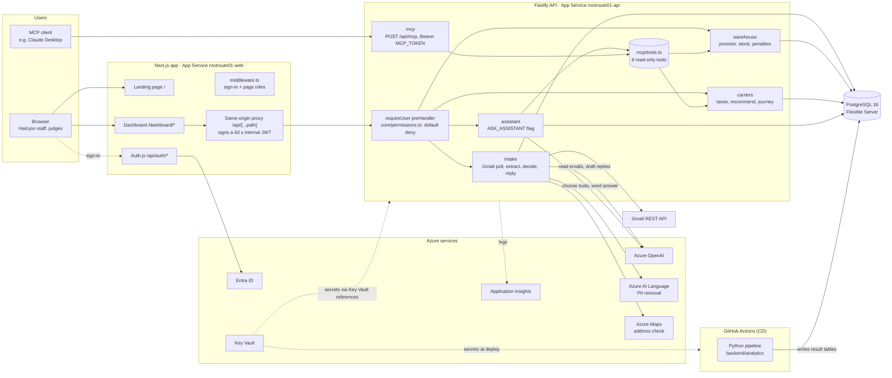
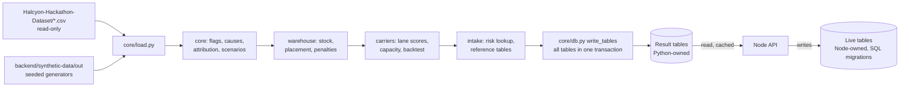

# Root Route — Architecture and decision log

Status: v1 · 30 Oct 2026 · Owner: spec-writer · Parent: `docs/SPEC.md` §4 (older docs and some UI strings say
"LateLens"; it is the same product). This page describes the system **as the code is today**. Where SPEC §4.1 still
says otherwise (hosting of the web app, Node version), this page follows the code and `infra/setup.sh`.

## 1. Runtime

How to read it:
- The **browser never calls the API directly** once sign-in is enforced (`AUTH_REQUIRED=on`). It calls same-origin
  `/api/*`; the Next.js proxy checks the session and forwards with a 60 s HS256 token (`SPEC-auth.md` §5.1, §5.2).
- The API refuses every route that is not listed in `backend/api/src/core/permissions.ts` (REQ-AUTH-06). Only
  `GET /api/health` and `POST /api/mcp` (own bearer token) are open.
- The AI model is called from two places only: the **intake** module (extract an order from an email, draft a reply,
  draft a complaint response) and the **assistant** (choose read-only tools, word the answer). Code makes every
  decision; a person approves every WMS entry (SEC-04).
- `LLM_PROVIDER`, `PII_PROVIDER` and `ADDRESS_PROVIDER` default to `recorded`, so CI and local runs replay saved
  responses and need no Azure keys (`backend/api/src/core/config.ts`).

## 2. Data flow: "Python computes, Node looks up"

| Who writes | Tables (full list in SPEC §4.2) | How |
|---|---|---|
| Python, `backend/analytics/` | Analysis results: `delivery_causes`, `kpis`, `cause_attribution`, `lane_scores`, `carrier_capacity`, `scenario_results`, `risk_lookup`, `placement_suggestions`, `penalty_reconciliation`, … | `pipeline.py` runs the four steps in order and fails if a step rewrites a table an earlier step owns; `core/db.py` replaces every table in one transaction |
| Node, `backend/api/` | Live work: `intake_emails`, `intake_extractions`, `outbound_messages`, `recommendations`, `override_log`, `audit_log`, `complaint_triage`, `alerts`, … | SQL migrations `backend/db/migrations/` (001 core, 1xx intake, 3xx carriers); `npm run migrate`, `npm run seed` |

**One writer per table.** Node applies only order-time rules (cut-off, nearest warehouse, capacity cap, decision
states) over Python's tables, so the replay and the live app cannot disagree (SPEC §4.2). The API memoises reads of
Python tables (`core/cache.ts`) because they do not change while the server runs.

## 3. Tech stack

| Layer | Tool | Version (where pinned) | Where |
|---|---|---|---|
| Web app | Next.js, React, TypeScript | next ^15.5, react ^19.1, typescript ^5.9 | `frontend/package.json` |
| Sign-in | Auth.js (next-auth) with Microsoft Entra ID and demo credentials | next-auth 5.0.0-beta.32, jose 6.2.12 | `frontend/auth.ts` |
| Landing animation | GSAP, Lenis | gsap ^3.13, lenis ^1.3 | `frontend/package.json` |
| API | Node, Fastify, zod, pg | Node 24 (CI, CD, App Service `NODE:24-lts`), fastify ^5.12, zod ^4.6, pg ^8.23 | `backend/api/package.json` |
| MCP server | `@modelcontextprotocol/sdk` | 1.32.1 (pinned) | `backend/api/src/modules/mcp/` |
| AI model client | `openai` SDK against Azure OpenAI | openai ^7.45; deployment `[AI_MODEL]` (today gpt-5-mini, SPEC §14.1) | `backend/api/src/core/llm/` |
| Data pipeline | Python, pandas, numpy, SQLAlchemy, psycopg | Python 3.12, pandas >=2.2 | `requirements.txt` |
| Team's ML model (not in the live path) | LightGBM, scikit-learn, scipy | lightgbm >=4.3 | `requirements-ml.txt`, `backend/carrier-optimization-engine/` |
| Database | PostgreSQL | 16 (Docker locally, Flexible Server on Azure) | `docker-compose.yml`, `infra/setup.sh` |
| Tests | Vitest, Testing Library, Playwright, pytest, ruff | vitest ^5.0, @playwright/test 1.64.1, pytest >=8.0 | package files, `pytest.ini`, `ruff.toml` |
| CI/CD | GitHub Actions, gitleaks, Azure OIDC login | actions pinned by commit hash | `.github/workflows/ci.yml`, `cd.yml` |

## 4. Hosting and deploy

| Resource (team group `rg-unhandled-rejections`, prefix `rootroute01`) | Detail | Source |
|---|---|---|
| App Service plan | One Linux plan, B1, runs both apps | `infra/setup.sh` |
| `…-web` | Next.js server (`next start`): landing page, dashboard, Auth.js, proxy | `infra/setup.sh`, `cd.yml` |
| `…-api` | Fastify API, managed identity reads secrets through Key Vault references | `infra/setup.sh` |
| PostgreSQL Flexible Server | Burstable B1ms, 32 GB, version 16; firewall admits Azure services; CD opens a one-run rule for its runner and removes it | `infra/setup.sh`, `cd.yml` |
| Key Vault `…-kv` | `database-url`, `api-key`, `mcp-token`, `auth-demo-password`, AI keys | `infra/setup.sh`, `cd.yml` |
| Application Insights + Log Analytics | Requests, plus the API's console logs through a diagnostic setting (NFR-03) | `infra/setup.sh` |

Pipeline: **CI** on every PR and push to `main` (ruff, pytest golden numbers, synthetic data reproducible, pipeline +
migrations + seed into a Postgres 16 service, API and dashboard tests with recorded AI answers, typecheck, builds,
gitleaks). **CD** runs only after a green CI on the head of `main`: OIDC login → read secrets from Key Vault → open
the database firewall for this runner → regenerate synthetic data and run the Python pipeline → migrate and seed →
close the firewall → deploy API and web app → restart web → smoke check that `/api/health` reports the new commit and
`/dashboard` serves the new build → Playwright e2e signed in with the demo accounts. Azure resources are created once
by `infra/setup.sh` (az CLI); rollback is redeploying the previous commit and rerunning the pipeline (SPEC §9.3).

## 5. Decision log

| # | Decision | Chosen | Alternative considered | Why | Trade-off | Source |
|---|---|---|---|---|---|---|
| 1 | How causes and risk are computed | Rules: five exact cause flags, a lane block rule, a lookup-table risk score | A trained model (the team's LightGBM, AUC ≈ 0.83) | Rules are explainable to an operator, testable to exact golden counts and demo-reliable | Less predictive power; the model stays phase 2 in `carrier-optimization-engine/` | CLAUDE.md "simple rules over ML"; SPEC §5.1, §5.5 |
| 2 | Where analysis runs | Python pipeline writes result tables; Node only looks them up | Compute statistics in the Node API | pandas suits the analysis; one implementation means the replay and the live app cannot disagree | Two languages in the repo; results are only as fresh as the last pipeline run | SPEC §4.2; CLAUDE.md |
| 3 | When results are computed | Pre-computed tables, replaced in one transaction per run, cached by the API | Live queries over the raw deliveries per request | Fast reads (NFR-01 target 2 s p95) and a dashboard that never shows half-written results | Full rebuild on every run; a window or new data needs a rerun | `core/db.py`; `core/cache.ts`; `SPEC-data-upload.md` §3 |
| 4 | What the AI model may do | Read emails, draft replies, answer data questions from read-only tools. Code decides; a person approves WMS entry | Let the model decide order states or act | Email is untrusted input (SEC-02); an approval gate stops a spoofed sender (SEC-04) | More operator clicks; SEC-06 specifies the one exception (address corrections) | SPEC §4.4, §8; CLAUDE.md; §14.1 (29 Oct, Q-ASK-01) |
| 5 | Gmail access in the intake | Gmail REST API called by code | A Gmail MCP server given to the model | Google's server had no send tool, polling needs no MCP, and a mailbox tool would let an email's text trigger actions | We maintain the Gmail client code ourselves (`core/gmail.ts`) | SPEC §4.4; §14.1 (27 Oct) |
| 6 | Tools for model-driven questions | One registry of six read-only tools, served over MCP and to the in-app assistant | Separate tool sets per surface, or tools that write | One definition, one review; no tool sends, approves or writes | The assistant can answer only what the tools cover; everything else is refused | SPEC §4.4, §5.14, §5.16 |
| 7 | Trusting assistant answers | Code checks every figure against tool results and lists sources; never labelled "verified" | Show the model's text as is | A figure the tools did not return is not shown as an answer | The check proves a figure's origin, not that it is quoted for the right measure | SPEC §5.16 "Figure check"; §14.1 (30 Oct) |
| 8 | Carrier scoring input | Fair data only (no address, stock or cut-off cause); D on Friday handled by a capacity cap | Raw late rates; blocking D everywhere | Raw rates blame carriers for causes before pickup; D is reliable except on Fridays | Smaller samples per lane (block when fair n < 30) | SPEC §5.1, §5.2 (REQ-CAR-02); §14.1 (26 Oct) |
| 9 | Web framework for the API | Fastify with zod schemas, routes autoloaded per module | — (no alternative recorded) | Stack fixed on day one in CLAUDE.md and SPEC §4.1; one module folder per problem area | — | CLAUDE.md; SPEC §4.1, §4.3 |
| 10 | Database and schema changes | PostgreSQL with plain SQL migrations; Python loads the dataset | ORM (TypeORM) migrations | SQL files numbered per area (1xx, 2xx, 3xx) avoid merge clashes; the pipeline already loads the data | No generated types from the schema; contracts kept by hand in `CONTRACTS.md` | §14.1 (28 Oct); `backend/db/migrations/` |
| 11 | Hosting the web app | App Service running `next start`, same plan as the API | Azure Static Web Apps (SPEC §4.1's original plan) | The middleware (sign-in, page roles, maintenance mode) needs a Node server | One B1 plan shared by both apps | `infra/setup.sh` ("its middleware needs a server"); `frontend/middleware.ts` |
| 12 | Sign-in architecture | Entra ID (single tenant) plus demo accounts; Next.js backend-for-frontend with a 60 s internal JWT; API default deny | Browser calling the API with a shared key (before P7) | The key shipped to browsers; actors must come from a verified token | Two hops per request; a shared secret between web and API | `SPEC-auth.md` §2, §5.1, §5.2; §14.1 (29 Oct) |
| 13 | CI against AI services | Recorded responses keyed by prompt hash (`*_PROVIDER=recorded`) | Calling Azure OpenAI, Language and Maps in every CI run | Fast, free and repeatable tests; no keys in CI | Recordings must be refreshed (`RECORD=1`) when a prompt changes | SPEC §4.4 "LLM interface"; `core/llm/index.ts` |
| 14 | Shipping unfinished features | Flags that default off: `AUTH_REQUIRED`, `ASK_ASSISTANT`, `CONFIRM_LINK` | Long-lived feature branches | Merge to `main` early, deploy continuously, turn on when reviewed | Both code paths must keep working and be tested | `backend/api/src/core/config.ts`; SPEC "Changes in v0.10/v0.11" |
| 15 | Azure sign-in from CD | GitHub OIDC federated credential, secrets read from Key Vault | A stored service-principal password in GitHub | No long-lived Azure secret in GitHub | Tenant must allow app registrations; subject claim must match | §14.1 (26 Oct); `infra/setup.sh`; `cd.yml` |

## 6. Known limits

- **Python is not on the Azure API host.** The pipeline runs only in GitHub Actions CD, so results change only on a
  deploy (or a manual CD run with `refresh_data`). Running Python next to the API is task U15 in
  [`SPEC-data-upload.md`](SPEC-data-upload.md) §3, §10.
- **Full table rebuild per run.** Every result table is replaced from the whole dataset each run; there is no
  incremental or windowed analysis yet (`SPEC-data-upload.md` §3, U2 and U8).
- **CSV input.** The analysis reads the supplied CSVs from the repo; a database source, uploads and a data store are
  specified, not built ([`SPEC-data-upload.md`](SPEC-data-upload.md) §2, §4).
- **Fixed constants from the supplied period.** Bad lanes (`core/load.py`), the backtest split (`carriers/backtest.py`)
  and the Aug–Sep segment are fixed to the supplied dates (`SPEC-data-upload.md` §3, U4, U5).
- **Single instance state.** The API's table cache and the assistant's rate limits live in process memory (SPEC
  v0.12 note "rate limits are per process"; `core/cache.ts`), so scaling out would need a shared store.
