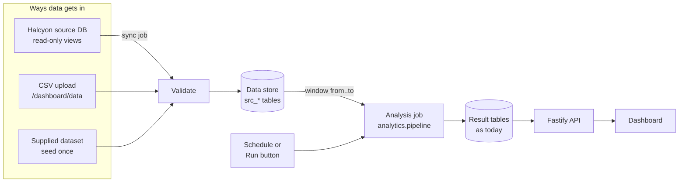

# SPEC: Data store, source connection and windowed analysis

Status: draft v2 · Date: 2026-10-29 · Parent: `docs/SPEC.md` (§4.2, §5.1, §5.7, §8) · Contracts: `docs/CONTRACTS.md`
Ids: `REQ-DATA-*`, `NFR-DATA-*`, `SEC-DATA-*`, `AC-DATA-*` · Tasks: `U1`–`U17` (§10)

---

## 1. Problem

Today the analysis reads CSV files from `Halcyon-Hackathon-Dataset/` each time someone runs `npm run pipeline` by hand,
over the whole file, and writes the result tables the dashboard reads. That does not work for a real customer:

- Halcyon's delivery data lives in their own systems and grows every day. It must be **read from a database**, not
  re-supplied as files.
- Data loaded once must be **stored** and reused. It must not be re-uploaded or re-read in full for every analysis.
- Users need the analysis for a **calendar window** they choose (e.g. last 90 days), always on the latest data.

The jury scorecard also asks for a run "from UI to final result" on the jury's own and larger inputs (2.1), clear
messages for bad inputs (2.2) and a timed run on realistic volume (4.2). This spec covers both.

The analysis itself does not change: same cause flags (SPEC §5.1), same result tables, same screens. The background
job is the existing rule-based Python pipeline, not an LLM agent (CLAUDE.md).

## 2. Target flow

1. **Data in, once.** Every source goes through the same validation into one store (`src_*` tables in our Postgres),
   matched by primary key. Data is stored there and never reloaded unless it changed.
2. **Analysis for a window.** A run reads only the store rows in the chosen window, computes the result tables, and
   replaces them in one transaction (as `write_tables` does today).
3. **Latest data.** When a source database is configured, each analysis run first syncs the window from it. A daily
   schedule can sync and analyse a rolling window with no user action.

### 2.1 "What if it is a real database?"
Halcyon's database is a **source**, not our store. We connect to it read-only, copy the window we need into the
store, and analyse from the store. Reasons:
- The analysis never queries the customer's production system directly, so it adds no load to it beyond one
  windowed read per sync.
- Uploads, the seed and the database all end in the same validated tables, so the analysis has one input.
- If the source is down, the last synced data still serves the dashboard.

The connector expects the source to expose one view per data-dictionary file (`deliveries`, `clients`,
`sla_penalties`, `complaints`), with the data-dictionary column names. Mapping Halcyon's real schema onto those views
is onboarding work on the customer side (Q-DATA-01). For the demo, a second local Postgres database
(`halcyon_source`) seeded from the supplied CSVs stands in for Halcyon's system, labelled as a simulation.

## 3. What exists and what changes

| Exists today | File | Change |
|---|---|---|
| `load(data_dir)` reads CSVs; `Ctx.csv(name)` reads the other files | `analytics/core/load.py`, `core/context.py` | Read from the store for a window: `load_window(engine, from, to)`, `Ctx.table(name)` (U2) |
| `pipeline.py` always analyses the whole supplied dataset | `analytics/pipeline.py` | `--from/--to`, progress lines, run summary (U8) |
| `write_tables` replaces every result table in one transaction | `analytics/core/db.py` | None. The dashboard keeps showing the old results until a run commits |
| Bad lanes are a fixed list `BAD_LANES` | `analytics/core/load.py:20` | Derive from the window's data (U4) |
| Backtest split is fixed: `SPLIT = 2026-08-01` | `analytics/carriers/backtest.py:9` | Relative to the window (U5) |
| Segment `aug_sep` is fixed to months ≥ 8 | `analytics/core/diagnosis.py:34` | "Last two months of the window" (U5) |
| API caches result tables "that never change while the server runs" | `api/src/core/cache.ts` | `clearCache()` after every successful analysis (U9) |
| Shell hard-codes "48,340 deliveries" and "Apr–Sep 2026" | `frontend/components/dashboard/DashboardShell.tsx:50,72` | Read the window from the API (U16) |
| API web app is Node only; the pipeline runs only in GitHub Actions | `infra/setup.sh:58`, `.github/workflows/cd.yml:143-155` | Python runs next to the API (U15) |

## 4. Data store

Tables in our Postgres. Schema by Node migration `003_data_store.sql`. **Written only by Python ingest** (one writer,
SPEC §4.2). Columns and types are exactly those in `Halcyon-Hackathon-Dataset/DATA_DICTIONARY.md`.

| Table | Key | Index |
|---|---|---|
| `src_deliveries` | `delivery_id` | `order_received_ts` |
| `src_clients` | `client_id` | |
| `src_sla_penalties` | `penalty_id` | `delivery_id` |
| `src_complaints` | `complaint_id` | `delivery_id` |
| `src_carriers`, `src_warehouses`, `src_warehouse_region_distance` | `carrier_id` / `warehouse_id` / `warehouse_id` | |

Every row also stores `loaded_by` (ingest job id) and `loaded_at`.

**Ingest modes:**
- `merge` (default): insert new keys, replace rows whose key already exists.
- `replace`: empty all `src_*` tables, then load. Used to test with a clean dataset, and by "Reset to supplied data".

**In-flight deliveries.** A real source holds orders not yet delivered. A delivery with `delivered_date`, `days_late`
and `on_time` all blank is **in flight**. It is stored, but no analysis counts it, because its lateness is not yet
known. The run summary reports how many were left out.

## 5. Requirements

### 5.1 Data in

| Id | Requirement |
|---|---|
| REQ-DATA-01 | The supplied dataset **MUST** be loadable into the store with one command (`npm run ingest -- --supplied`), replacing direct CSV reads in `npm run pipeline` and in CD. |
| REQ-DATA-02 | An admin **MUST** be able to upload CSVs (§4.4 files) from `/dashboard/data`, choosing `merge` or `replace`. Uploaded rows are stored; analysis never needs the file again. |
| REQ-DATA-03 | When `SOURCE_DATABASE_URL` is set, the system **MUST** be able to sync a date window from the source views into the store (`merge`), on demand and before each analysis run. |
| REQ-DATA-04 | Every ingest (seed, upload, sync) **MUST** validate all rows (rules §6) before writing, and **MUST** write nothing if any rule fails. |
| REQ-DATA-05 | A rejected ingest **MUST** show the total error count and the first 20 errors, each with source, line or key, column and a plain sentence (e.g. `deliveries.csv line 1,204, commitment_type: "sameday" is not one of same_day, next_day, standard`). |
| REQ-DATA-06 | `/dashboard/data` **MUST** show what the store holds: rows per table, the earliest and latest `order_received_ts`, in-flight count, the last ingest (type, time, rows) and the last sync. |

### 5.2 Analysis

| Id | Requirement |
|---|---|
| REQ-DATA-07 | An admin **MUST** be able to choose a window (`from`, `to` dates on `order_received_ts`, inclusive) and start an analysis. Defaults: the latest `ANALYSIS_DEFAULT_DAYS` of stored data. |
| REQ-DATA-08 | A window **MUST** be refused with a reason when `from` > `to`, when it lies outside the stored date range, or when it is shorter than `ANALYSIS_MIN_DAYS`. |
| REQ-DATA-09 | The analysis **MUST** use only store rows in the window: deliveries by `order_received_ts`, and penalties and complaints whose `delivery_id` is in those deliveries; clients and reference tables in full. In-flight deliveries are excluded. |
| REQ-DATA-10 | The analysis runs in a background process. The request returns at once with a run id, and the page shows the live stage (`queued`, `syncing`, then each pipeline step, then `succeeded` or `failed`), checking every 2 s. |
| REQ-DATA-11 | When a run succeeds, every dashboard screen **MUST** show its results on the next load, with no restart. |
| REQ-DATA-12 | Every dashboard screen **MUST** show which data it is computed from: the window, deliveries analysed, in-flight excluded, and when the run finished, taken from the API (no figures in code). |
| REQ-DATA-13 | The run summary **MUST** show: deliveries analysed, in-flight excluded, the data-quality counts from `dq_report`, time per step, and any analysis skipped for lack of history (REQ-DATA-16). |
| REQ-DATA-14 | Analysis that depends on dates **MUST** be relative to the window: bad lanes derived from the window's data (§6.3); the backtest test period and the `aug_sep` segment become "the last two calendar months of the window". On the full supplied window (2026-04-01 to 2026-09-25) every result table **MUST** equal today's output. |
| REQ-DATA-15 | When `ANALYSIS_SCHEDULE_HOUR` is set, the API **MUST** once a day sync (if a source is configured) and analyse the latest `ANALYSIS_DEFAULT_DAYS` days, recording the run as `scheduled`. |
| REQ-DATA-16 | If the window has less than three calendar months, the carrier backtest **MUST** be skipped and shown as "not enough history (needs 3 months)", while all other analyses run. |
| REQ-DATA-17 | Only one job (ingest, sync or analysis) **MUST** run at a time; a second request is refused with a message naming the active job. |
| REQ-DATA-18 | A failed job **MUST** leave the store and the previous results unchanged and show a readable reason. Stack traces are logged, never shown. |

### 5.3 Non-functional

| Id | Requirement |
|---|---|
| NFR-DATA-01 | Limits are configuration: `UPLOAD_MAX_MB` (default 100), `UPLOAD_MAX_ROWS` (500,000, about 10× the supplied 48,340), `JOB_TIMEOUT_S` (900), `ANALYSIS_MIN_DAYS` (28), `ANALYSIS_DEFAULT_DAYS` (90). Defaults are reviewed after U17 measures the run times. |
| NFR-DATA-02 | Run summaries record time per step, so 1× and 10× volumes are measurable (scorecard 4.2). |
| NFR-DATA-03 | An API restart while a job is running **MUST** mark it `failed` ("interrupted by restart") at startup. |
| NFR-DATA-04 | One writer per table (SPEC §4.2): Node writes `jobs`; Python writes `src_*`, the result tables and `analysis_info`. |
| NFR-DATA-05 | Reading a window **MUST** use the `order_received_ts` index and **MUST NOT** load the whole store into memory. |

### 5.4 Security

| Id | Requirement |
|---|---|
| SEC-DATA-01 | Upload, sync, analysis-run and reset routes **MUST** be allowed for `admin` only (default deny, `core/permissions.ts`). Read routes for the data source line are open to every role. |
| SEC-DATA-02 | `SOURCE_DATABASE_URL` **MUST** use a read-only account and live in Key Vault or the local `.env`, never in code. The connector only runs `SELECT` on the four allow-listed views, with the window passed as query parameters. |
| SEC-DATA-03 | Uploaded files are untrusted: parsed as CSV values only. Written only to `UPLOAD_DIR/<jobId>/` with names from the allow-list (§4.4); any other name is refused. `UPLOAD_DIR` is gitignored; `Halcyon-Hackathon-Dataset/` is never written. |
| SEC-DATA-04 | Every ingest, sync, analysis run and reset **MUST** write an `audit_log` row (actor, action, ref = job id, payload = window or file names and sizes). |
| SEC-DATA-05 | Requests over `UPLOAD_MAX_MB` **MUST** be refused with 413 before parsing. |

### 5.5 Files accepted by upload (REQ-DATA-02)

| File | Required | Notes |
|---|---|---|
| `deliveries.csv` | Yes | |
| `clients.csv` | No | Every `client_id` in deliveries must then exist in the store after the load |
| `sla_penalties.csv`, `complaints.csv` | No | Their `delivery_id`s must exist in the store after the load |
| `carriers.csv`, `warehouses.csv`, `warehouse_region_distance_miles.csv` | Not accepted | Loaded only by the seed |

## 6. Validation (Python, `backend/analytics/ingest/validate.py`)

### 6.1 Every input
Not empty (header and at least one row; penalties and complaints may be header-only) · UTF-8 CSV or rows from the
source view · every data-dictionary column present (a missing one is an error naming it; extra columns are ignored
with a warning) · row count ≤ `UPLOAD_MAX_ROWS` for uploads.

### 6.2 Column rules (from `DATA_DICTIONARY.md` and `CONTRACTS.md` §1)

| Table | Rule |
|---|---|
| deliveries | `delivery_id` non-blank, unique in the input |
| deliveries | `order_channel` ∈ {EDI, API, Email}; `commitment_type` ∈ {same_day, next_day, standard}; `address_status` ∈ {complete, incomplete}; `destination_region` ∈ {Midwest, Northeast, Southeast, West}; warehouses ∈ {W1…W5}; `carrier_id` ∈ {A…F}; `nearest_warehouse_had_stock` ∈ {Y, N}; `on_time` ∈ {Y, N} or in flight |
| deliveries | `order_received_ts`, `shipped_ts` as `YYYY-MM-DD HH:MM`; `promised_date`, `pick_list_date`, `delivered_date` as `YYYY-MM-DD` |
| deliveries | `distance_miles`, `carrier_rate_usd`, `stops_on_route`, `planned_route_km`, `redelivery_cost_usd` numeric; `days_late` numeric or in flight; `actual_route_km` numeric or blank; `email_format_id` 1–14 or blank |
| deliveries | Non-blank: every column except `email_format_id`, `actual_route_km`, and (in flight only, all three blank together) `delivered_date`, `days_late`, `on_time` |
| deliveries | `client_id` exists in the store's clients after the load |
| clients | `client_id` unique; `account_tier` ∈ {Tier 1, Tier 2, Tier 3}; `sla_penalty_clause` ∈ {Y, N}; `account_status` ∈ {active, threatening_to_leave}; `annual_revenue_usd` numeric |
| sla_penalties | `delivery_id` exists after the load; `days_late`, `penalty_usd` numeric |
| complaints | `delivery_id` exists after the load; `complaint_date` as `YYYY-MM-DD` |

The existing data-quality checks (`diagnosis.add_dq`) are reported, not blocking, as today.

### 6.3 Bad-lane rule (REQ-DATA-14)
A (carrier, destination_region) lane is bad when, on FAIR deliveries in the window (SPEC §5.1) excluding carrier D on
Fridays, it has at least `lanes.MIN_N` (30) deliveries and a late rate above `lanes.MAX_LATE` (15%). This reuses the
constants in `analytics/carriers/lanes.py`. **Gate:** on the full supplied window the rule **MUST** return exactly
the current `BAD_LANES`. If it does not, the implementer stops and reports the difference; the rule is not tuned to
fit. `f_d_friday` stays a fixed rule (Q-DATA-02).

## 7. Design

### 7.1 Python commands
- `python -m analytics.ingest --supplied` → `replace` with the supplied dataset (all seven files).
- `python -m analytics.ingest --csv-dir <dir> --mode merge|replace` → upload.
- `python -m analytics.ingest --source-db --from YYYY-MM-DD --to YYYY-MM-DD` → sync from `SOURCE_DATABASE_URL` (`merge`).
- `python -m analytics.pipeline --from YYYY-MM-DD --to YYYY-MM-DD [--test-db]` → analysis. With no dates: the full
  stored range.

All commands print one JSON line per stage to stdout (`{"stage":"validate"}`, `{"stage":"write"}`; for the
pipeline: `load`, `core`, `warehouse`, `carriers`, `intake`, `write`). They print one final line
`{"result": {...}}` and exit `0` succeeded, `2` refused (validation or window), `1` other failure.

Result shapes:
- ingest `{"ok","mode","rows":{table:n},"inFlight":n,"errorCount":n,"errors":[{"source","line|key","column","message"}],"warnings":[...]}`
  (`errors` holds the first 20)
- pipeline `{"ok","from","to","deliveries":n,"inFlightExcluded":n,"dq":[{"issue","count"}],"skipped":[{"analysis","reason"}],"stepMs":{...}}`

The pipeline also writes table `analysis_info` (one row): `job_id`, `window_from`, `window_to`, `deliveries`,
`in_flight_excluded`, `finished_at`.

### 7.2 Table `jobs` (Node-owned, migration `002_jobs.sql`)
`id serial PK · kind ('seed'|'upload'|'sync'|'analysis'|'reset') · trigger ('user'|'scheduled') · status ('queued'|'running'|'succeeded'|'failed') ·
stage text · actor text · params jsonb (window, mode, file names) · result jsonb · error text · created_at · started_at · finished_at`

### 7.3 API (module `backend/api/src/modules/data/`)

| Route | Roles | Body / response |
|---|---|---|
| `GET /api/data/coverage` | admin | Store row counts, `dateFrom`, `dateTo`, `inFlight`, last ingest and last sync (REQ-DATA-06), `sourceConfigured: bool` |
| `POST /api/data/uploads` | admin | `{"mode":"merge"|"replace","files":{"deliveries.csv":"<csv text>",...}}`, route `bodyLimit` = `UPLOAD_MAX_MB`. **202** `{"jobId"}` · **400** `invalid_upload` (no deliveries.csv, unknown name, empty) · **409** `job_running` · **413** `too_large` |
| `POST /api/data/sync` | admin | `{"from","to"}` · **202** `{"jobId"}` · **409** · **400** `no_source` when `SOURCE_DATABASE_URL` is unset |
| `POST /api/data/reset` | admin | Re-seeds the supplied dataset (`replace`), then analyses its full range · **202** `{"jobId"}` |
| `POST /api/analysis/runs` | admin | `{"from","to"}` · **202** `{"jobId"}` · **400** `bad_window` with reason · **409** |
| `GET /api/jobs/:id` | admin | `{"jobId","kind","trigger","status","stage","params","result","error","createdAt","startedAt","finishedAt","durationMs"}` · **404** |
| `GET /api/jobs` | admin | Last 20 jobs, newest first |
| `GET /api/analysis/current` | all roles | `{"from","to","deliveries","inFlightExcluded","finishedAt","jobId"}` from `analysis_info` |

An analysis job with a source configured runs the sync for its window first (stage `syncing`), then the pipeline.
After a pipeline succeeds the runner calls `clearCache()`.

New env (`core/config.ts`, `.env.example`, `docs/CONTRACTS.md` §7): `SOURCE_DATABASE_URL` (optional), `UPLOAD_DIR`
(default `backend/.uploads`), `UPLOAD_MAX_MB`, `UPLOAD_MAX_ROWS`, `JOB_TIMEOUT_S`, `ANALYSIS_MIN_DAYS`,
`ANALYSIS_DEFAULT_DAYS`, `ANALYSIS_SCHEDULE_HOUR` (0–23, unset = off), `PYTHON_BIN` (default `python3`).

### 7.4 Frontend: `/dashboard/data` ("Data", `admin` only)
Built from `components/dashboard/ui.tsx`; primary buttons use `--navy`; confirmations are in the page (no `confirm()`).
Three panels:
1. **Stored data:** coverage (REQ-DATA-06). "Sync from source" with a window, shown only when a source is configured.
   "Reset to supplied data" with an in-page confirmation.
2. **Upload:** deliveries required, three optional; merge/replace choice; `.csv` only; size checked in the browser.
   States: choose → uploading → validating → stored (rows per table) or rejected (error count and a table of up to 20 errors).
3. **Analysis:** `from`/`to` date pickers limited to the stored range, defaulting to the latest
   `ANALYSIS_DEFAULT_DAYS`. "Run analysis" → live stage list → summary (REQ-DATA-13) with "Open Overview", or the
   failure reason. A list of recent jobs below.

`DashboardShell` reads `GET /api/analysis/current` and shows the data line on every screen (REQ-DATA-12), replacing
the hard-coded text at lines 50 and 72. The page states facts only; it makes no decisions (CLAUDE.md product rule).

## 8. Acceptance criteria

| Id | Covers | Given / when / then |
|---|---|---|
| AC-DATA-01 | REQ-DATA-01, 14 | Given `ingest --supplied` then `pipeline` with no dates, every result table equals today's CSV-based output (regression baseline taken before U2 merges). |
| AC-DATA-02 | REQ-DATA-07, 09, 11 | Given the supplied store, when analysing 2026-04-01 to 2026-06-30, then `/api/analysis/current` shows that window and the count of deliveries received in it, and `/api/overview` changes with no API restart. |
| AC-DATA-03 | REQ-DATA-08 | Given `from` > `to`, a window outside the stored range, or a window shorter than `ANALYSIS_MIN_DAYS`, then **400** `bad_window` with the reason, and no job is created. |
| AC-DATA-04 | REQ-DATA-16 | Given a two-month window, then the run succeeds, `skipped` contains the backtest with "not enough history (needs 3 months)", and the other tables are written. |
| AC-DATA-05 | REQ-DATA-14 | Given the full supplied window, the derived bad-lane set equals `{(D,Midwest),(D,Southeast),(E,West),(F,Northeast),(F,Southeast)}`. |
| AC-DATA-06 | REQ-DATA-04, 05 | Given an upload with `commitment_type` = `sameday` on line 5, then the job fails, the first error names the file, line 5, the column and the allowed values, and no `src_*` row changed. |
| AC-DATA-07 | REQ-DATA-04 | Given a missing `carrier_id` column, a duplicate `delivery_id`, an unknown `client_id`, a bad date or a non-numeric `carrier_rate_usd`, then each gives its own error with line and column. |
| AC-DATA-08 | REQ-DATA-02 | Given an empty `deliveries.csv`, or a file named `carriers.csv` or `../x.csv`, then **400** `invalid_upload`; nothing written. |
| AC-DATA-09 | SEC-DATA-05, NFR-DATA-01 | Given a body over `UPLOAD_MAX_MB`, then **413**; given rows over `UPLOAD_MAX_ROWS`, then rejected stating the limit. |
| AC-DATA-10 | REQ-DATA-02 | Given an upload in `merge` mode with one existing `delivery_id` changed and one new, then the store has the changed row replaced and the new row added; the other rows are unchanged. |
| AC-DATA-11 | REQ-DATA-02 | Given an upload in `replace` mode, then `src_deliveries` holds exactly the uploaded rows. |
| AC-DATA-12 | §4 in flight | Given 10 deliveries with blank `delivered_date`, `days_late` and `on_time`, then they are stored, coverage shows 10 in flight, and the analysis reports `inFlightExcluded` = 10. A row with only `on_time` blank is rejected. |
| AC-DATA-13 | REQ-DATA-03, SEC-DATA-02 | Given `SOURCE_DATABASE_URL` pointing at `halcyon_source` (seeded from the supplied CSVs), when syncing April 2026 into an empty store, then `src_deliveries` holds exactly April's rows. Given a source account with write rights revoked, the sync still succeeds. |
| AC-DATA-14 | REQ-DATA-03 | Given a row in `halcyon_source` updated from in flight to delivered, when an analysis of its window runs, then it syncs first and the row counts as delivered. |
| AC-DATA-15 | REQ-DATA-15 | Given `ANALYSIS_SCHEDULE_HOUR` set and the clock passing that hour, then one `scheduled` analysis job runs for the latest `ANALYSIS_DEFAULT_DAYS`. |
| AC-DATA-16 | REQ-DATA-17 | Given a running job, another upload, sync or analysis request gets **409** `job_running` with the active job id. |
| AC-DATA-17 | REQ-DATA-18 | Given the Python process exits 1, then the job is `failed` with a readable reason, and the store and `/api/overview` are unchanged. |
| AC-DATA-18 | NFR-DATA-03 | Given a `running` job at API startup, it becomes `failed` with "interrupted by restart". |
| AC-DATA-19 | SEC-DATA-01 | Given a non-admin role, every POST in §7.3 returns 403; `GET /api/analysis/current` returns 200 for every role. |
| AC-DATA-20 | SEC-DATA-04 | Given any job, one `audit_log` row with its action and job id exists. |
| AC-DATA-21 | REQ-DATA-12 | Given any dashboard screen, the data line shows the window and counts from the API, and no screen contains the literal `48,340`. |
| AC-DATA-22 | REQ-DATA-10 | Given a running job, `/dashboard/data` shows the current stage and updates without a reload. |
| AC-DATA-23 | NFR-DATA-02, 05 | Given the 1× store and a 10× synthetic store, then a full-window analysis succeeds on both, and `stepMs` and peak memory are recorded in `docs/TEST-EVIDENCE.md`. |

## 9. Out of scope
- Mapping Halcyon's real schema onto the four source views (customer onboarding, Q-DATA-01).
- Change-data-capture or streaming; sync is on demand, before each analysis, and daily.
- Keeping results for several windows side by side: there is one current analysis; an earlier window is re-run
  (roadmap, Q-DATA-03).
- Deleting individual stored rows; Excel or other formats; uploading reference files.
- Retraining `backend/carrier-optimization-engine/` (not part of `analytics.pipeline`).
- Any LLM in ingest or analysis. Any recommendation or decision text on the Data page.
- A separate job-queue service (one child process at a time is enough at this scale).

## 10. Task board (agents pick tasks from here)

### 10.1 How an agent picks up work
1. Read this spec, `CLAUDE.md` and `docs/CONTRACTS.md`.
2. Take the **first** task whose Status is `todo` and whose dependencies are all `done`. Tasks without a shared
   dependency run in parallel.
3. Set its Status to `in-progress (<agent>)` in this file **before** writing code, so no other agent takes it.
4. Branch `U<n>-<task-title-in-lowercase-dashes>`. Follow `.claude/agents/implementer.md`: test first, full suite,
   run record in `docs/agent-runs/`. Name the AC ids in test names or docstrings.
5. Update `docs/CONTRACTS.md` for every table, route, JSON shape or env var the task adds.
6. Set Status to `done` (or `blocked: <reason>`) and stop. Stay inside the task's files.

### 10.2 Tasks

| Task | Lane | Title | Files | Depends on | ACs | Status |
|---|---|---|---|---|---|---|
| U1 | DB | Jobs and data store tables | `backend/db/migrations/002_jobs.sql`, `003_data_store.sql` | none | used by U2–U12 | todo |
| U2 | Python | Read a window from the store | `analytics/core/load.py` (`load_window`), `core/context.py` (`Ctx.table`), step modules' `ctx.csv` calls | U1 | AC-DATA-01, 02 | todo |
| U3 | Python | Validator | `analytics/ingest/validate.py`, `analytics/tests/test_ingest_validate.py`, fixtures `backend/tests/fixtures/ingest/` | none | AC-DATA-06, 07, 12 | todo |
| U4 | Python | Derive bad lanes from the window | `analytics/core/load.py`, `analytics/carriers/lanes.py` | none | AC-DATA-05 | todo |
| U5 | Python | Window-relative dates | `analytics/carriers/backtest.py` (`SPLIT`), `analytics/core/diagnosis.py` (`aug_sep`), plus every API/frontend reader of `aug_sep` | none | AC-DATA-01, 04 | partly done (S2, 30 Oct): split and `aug_sep` from `analytics/core/window.py`; the < 3-month skip (AC-DATA-04) is still todo |
| U6 | Python | Ingest: seed and CSV | `analytics/ingest/__main__.py`, `analytics/ingest/store.py` (merge/replace in one transaction); root `package.json` `ingest` script | U1, U3 | AC-DATA-01, 10, 11 | todo |
| U7 | Python | Ingest: source database sync | `analytics/ingest/source_db.py`; `backend/synthetic-data/generators/` seed for `halcyon_source` (labelled simulation); `docker-compose.yml` second database | U6 | AC-DATA-13, 14 | todo |
| U8 | Python | Pipeline window CLI and summary | `analytics/pipeline.py` (`--from/--to`, stages, final result line, `analysis_info`, in-flight exclusion, `skipped`) | U2, U4, U5 | AC-DATA-02, 03, 04, 12 | todo |
| U9 | API | Job runner | `api/src/modules/data/runner.ts`: spawn `PYTHON_BIN`, stage lines, `JOB_TIMEOUT_S`, one at a time, sync-then-analyse, `clearCache()`, startup recovery, `audit_log` | U1, U6, U8 | AC-DATA-16, 17, 18, 20 | todo |
| U10 | API | Data and analysis routes | `api/src/modules/data/routes.ts`, `core/permissions.ts`, `core/config.ts`, `.env.example` | U9 | AC-DATA-03, 08, 09, 19 | todo |
| U11 | API | Daily schedule | `api/src/modules/data/schedule.ts`, `api/src/index.ts` (same pattern as `startIntakePolling`) | U9 | AC-DATA-15 | todo |
| U12 | Python + CI | CD uses the store | `.github/workflows/cd.yml`, `.github/workflows/ci.yml` (`ingest --supplied` then `pipeline`) | U6, U8 | AC-DATA-01 in CI | todo |
| U13 | Frontend | Data page: stored data and upload | `frontend/app/dashboard/data/page.tsx`, `frontend/components/dashboard/data/`, `config/dashboard.ts`, `lib/auth/roles.ts` | §7.3 contract (build against it); U10 to finish | AC-DATA-22 | todo |
| U14 | Frontend | Data page: analysis window and jobs | `frontend/components/dashboard/data/` | U13 | AC-DATA-22 | todo |
| U15 | DevOps | Python next to the API on Azure | `infra/setup.sh`, `.gitignore` (`backend/.uploads/`), Key Vault entry for `SOURCE_DATABASE_URL` | U9 | deployed AC-DATA-02 | todo |
| U16 | Frontend | Data line in the shell | `frontend/components/dashboard/DashboardShell.tsx` | U10 | AC-DATA-21 | partly done (S2, 30 Oct): read from `GET /api/overview` (`kpis`); switch to `/api/analysis/current` once U10 lands |
| U17 | QA + Docs | Evidence and README | `backend/synthetic-data/generators/` (seeded 10× set, labelled synthetic), `docs/TEST-EVIDENCE.md`, `README.md` | U1–U16 | AC-DATA-23, all | todo |

U15 default, to confirm with the team: run the API as one container image holding Node and Python, with
`PYTHON_BIN` inside the image. The alternative is a separate small Python service the API calls. Record the choice
in the run record.

## 11. Scorecard mapping

| Criterion | Evidence this spec produces |
|---|---|
| 2.1 End-to-end flow | Upload or sync → store → analysis for a chosen window → dashboard, on unseen data (AC-DATA-02, 13) |
| 2.2 Bad inputs | Empty, malformed, oversized, missing-field and bad-window inputs each refused with a readable message (AC-DATA-03, 06–09) |
| 2.3 Output quality | Run summary with labels and units; data line on every screen (REQ-DATA-12, 13) |
| 3.4 Code quality | Window, limits and source in configuration; no fixed dates or lanes in code (REQ-DATA-14, NFR-DATA-01) |
| 4.2 Scalability | 1× and 10× timed runs; windowed reads; re-runs without re-uploads (AC-DATA-23) |
| 7.3 Security | Read-only source account in Key Vault, admin-only writes, audit log, size limits (SEC-DATA-01–05) |

## 12. Open questions

| Id | Question | Default until answered |
|---|---|---|
| Q-DATA-01 | Which Halcyon systems hold each data-dictionary field, and who builds the source views? | Demo against `halcyon_source`; listed as an onboarding step in the roadmap |
| Q-DATA-02 | Should the D-on-Friday overload rule also be derived from the data? | Kept fixed; listed as a known limitation |
| Q-DATA-03 | Keep results per window, so earlier windows open without a re-run? | One current analysis; per-window results on the roadmap |
| Q-DATA-04 | Does Azure App Service accept a request body of `UPLOAD_MAX_MB`? | Verify in U15; lower the default if refused |
| Q-DATA-05 | Which roles may start an analysis (e.g. leadership)? | `admin` only |
